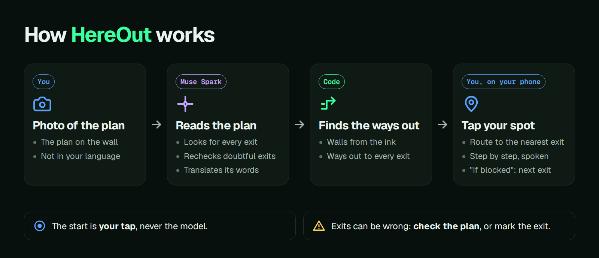
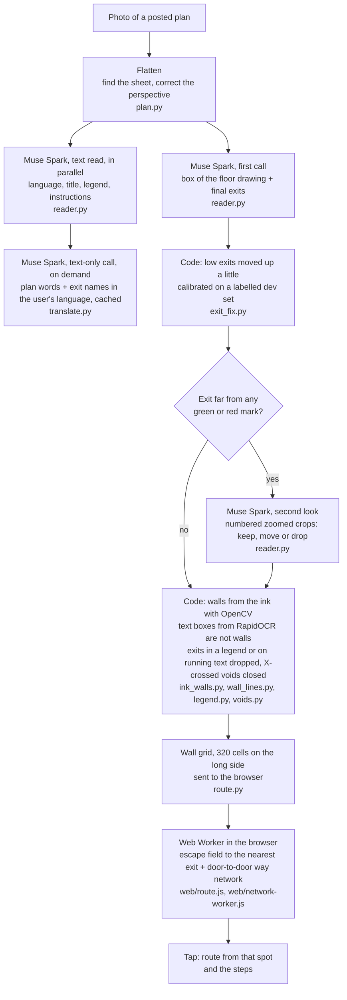

# HereOut

**Your way out, drawn on the plan.** Photograph a posted evacuation plan, tap where you stand, and HereOut draws the route to the nearest exit, step by step, in your language.

[Live demo](https://hereout.devrives.com/) · [Demo video](https://hereout.devrives.com/#demo) · Entry for the Meta Global AI Developer Hackathon (Indie track, 2026-10-26 to 2026-11-04 ET)



## Try it

1. Open <https://hereout.devrives.com/> and pick one of 203 photos of real plans, or upload your own.
2. Tap where you stand. "If blocked" switches the route to the next exit.
3. Open "What Muse Spark read" to see the model's points, the crops of its second look and what the code changed.

## What Muse Spark does

| Job | How | On the page |
|---|---|---|
| Exits | One call on the whole photo asks for the floor box and every final exit, as points on a 0 to 1000 grid | The numbered exits |
| Second look | Exits far from any green or red mark go on numbered, zoomed crops in one multi-image call; the model keeps, moves or drops each one | "What Muse Spark read", with the crops |
| Plan words | A parallel call reads the title, the legend and the printed instructions | "What the plan says", with the original under each item |
| Translation | A text-only call puts the plan words and exit names into 12 languages besides English, cached | The plan card in your language |

Walls, routes and steps come from code, and the start is always your tap. HereOut uses no other Meta model. Model: `meta-models/muse-spark-open-1026` through Baseten, standard mode only, every call under one spend cap.

<details>
<summary>Settings, prompts and time limits of each call</summary>

| Item | Value | Where |
|---|---|---|
| Model | `meta-models/muse-spark-open-1026` | `DEFAULT_MODEL` in `src/hereout/reader.py` |
| Provider | Baseten Model API, OpenAI-compatible chat completions (`https://inference.baseten.co/v1/chat/completions`) | `API_URL` |
| Mode | Standard mode only. The client refuses any model name that ends in `-contributor` (those send the content to training). | `ModelClient.__init__` |
| Settings | `reasoning_effort: low`, `temperature: 0`, `max_tokens: 12000` | `DEFAULT_EFFORT`, `MAX_TOKENS` |
| First call | `PROMPT`: the whole plan image (long side at most 1600 px); asks for the "final exits" and the box of the "floor drawing", as 0 to 1000 grid points, in JSON. A final exit is the end of an escape route: a door in the outer wall or the door of a protected staircase; on a plan with several levels, the exits of every level. | `PROMPT`, `parse_answer` |
| Second look | `ZOOM_PROMPT`: only for exits farther than 1.5 % of the long side from any green or red mark. Crops of 18 % of the long side around each suspect exit, marked with a cross, four to a sheet, with the full image. The model keeps, moves or drops each one. A move of more than 7 % of the long side is used only when the new point is on a green or red mark and inside the floor box. Skipped when the first call took more than 30 s. | `suspect_exits`, `zoom_exits`, `ZOOM_*` |
| Text read | `TEXT_PROMPT`: the same image, in parallel with the first call; the plan waits for it at most 2 s, and later words reach the page when the read ends. It gives the plan's language, title, legend entries and printed instructions (12 legend entries and instructions at most), each with its original text and an English text, and no positions. The plan opens without the words when the call fails. | `read_text`, `parse_plan_text` |
| Translation | `TRANSLATE_PROMPT`: a text-only call that translates the plan words and the exit labels into one of 12 languages, on demand. Gallery answers stay in a disk cache; the words of an uploaded photo stay in memory only. English needs no call, except for exit labels in another script. | `translate`, `src/hereout/translate.py` |
| Plan card texts | The texts of the plan card (steps, labels, messages) were translated once per language by Muse Spark with `scripts/translate_ui.py`. Three hand fixes after review (two Arabic steps, two Korean texts) are listed in `wiki/decisions/plan-language.md`. | `src/hereout/web/i18n/` |
| Time limits | 45 s for the first call (one more try on a timeout or a 5xx answer), 25 s for the second look | `CALL_TIMEOUT`, `ZOOM_TIMEOUT`, `MAIN_TRIES` |
| Spend cap | Every call goes through one `ModelClient`. It reserves the worst-case cost in a file ledger before the call and refuses a call that could pass the cap (`HEREOUT_SPEND_CAP_USD`, default 5 USD). A timed-out call is counted at the worst case. | `SpendLedger`, `ModelClient._ask` |
| Use limit | 12 photos to the model for each address in 10 minutes; after that the user marks the exits by hand | `READS_PER_WINDOW` in `src/hereout/app.py` |


On the 203 gallery plans, the second look was run on the saved readings (`scripts/zoom_saved.py`): 142 plans had at least one suspect exit. The card of each sample shows the crops and the result.

</details>

<details>
<summary>The full pipeline</summary>



- The model gives the floor box, the exits and the words of the plan.
- The browser finds every route. The server sends the wall grid once, and each tap is answered on the device.
- The steps name turns and say "short", "medium" or "long" walks. They give no metres, because a photo has no reliable scale.

</details>

## Evaluation

| Test | Result |
|---|---|
| Exits on 28 test photos that no exit rule was tuned on (radius 5 %) | Found 53 % of the sure exits (recall 0.53). 47 % of its scored exits were right (precision 0.47; exits on unsure labels not counted). Every exit was right on 6 of the 26 photos that could be judged. |
| All 203 gallery photos once through the photo button (code of 2026-11-01) | 203 opened, 0 failed, median 23.3 s from upload to plan ([each result](https://hereout.devrives.com/review/)) |

<details>
<summary>How the exits were measured</summary>

**Photo set.** 28 photos of posted plans from Wikimedia Commons, 14 countries and regions, none of them in the gallery that the code was tuned on: each photo that was in the gallery or near one (by title, source address or a perceptual hash) was left out. The photos are not in this repository.

**Labels.** Every final exit of each photo, as a point, by the definition in `PROMPT`. Each label is "sure" (the plan marks it: a route end, an exit sign, a legend exit icon) or "unsure" (the drawing suggests an exit but does not show it clearly). The labeller was an AI agent (Claude). It labelled by eye from the photos, with zoomed crops of each part of each plan, on 2026-11-01. The labeller saw no model reading of these photos before it labelled them. After the first scoring, each miss and false exit was checked on an overlay; one label was added (an outer door with no route, as "unsure"). Each change is logged in the labels file.

| | Count |
|---|---|
| Photos | 28 |
| Photos that cannot be judged | 2 (a town map with no building; a photo of a door that cuts off the plan) |
| Labelled exits | 112 (90 sure, 22 unsure) |

**Score** (`scripts/score_exits.py RUN_DIR labels.json`). Predicted exits are matched one to one to labels (Hungarian method) within a radius R = 5 % of the long side of the labelled floor box (at least 12 px). An unsure label may be matched or not; it is never a miss. Precision = hits / (hits + false exits); recall = hits / sure labels; "all right" = every sure label hit and no false exit. The script also reports R at 2.5 % and 10 %, and a strict score that counts unsure labels as sure.

| Code | R | Exit precision | Exit recall | Photos all right | Photos with a route |
|---|---|---|---|---|---|
| 2026-10-29 run (before later changes) | 2.5 % | 0.23 | 0.29 | 1 / 26 | 26 / 28 |
| | **5 %** | **0.42** | **0.52** | **4 / 26** | |
| | 10 % | 0.62 | 0.74 | 8 / 26 | |
| Run of 2026-11-01 | 2.5 % | 0.28 | 0.32 | 2 / 26 | 28 / 28 |
| | **5 %** | **0.47** | **0.53** | **6 / 26** | |
| | 10 % | 0.64 | 0.71 | 7 / 26 | |

"Photos with a route" means that the code found a way out for at least half of the open floor (`route_found` in `scripts/run_set.py`). It does not mean that the route is right.

The run of 2026-11-01 came before three later changes (far points of the second look on route marks, wall lines off the building, staircase steps). Each code version was run once. Two reads of the same photo can differ, so a change of a few hundredths is within noise.

**Dev set.** The code was tuned on a separate dev set: 30 gallery plans picked at random by country (seed 20261101), labelled the same way, by agents that had not seen the readings. On it, Muse Spark's exits in the lower half of the image were consistently a little too low, so `exit_fix.py` moves them up by 10 % of their distance below the middle (dev set, 5 %: precision 0.357 to 0.391, recall 0.348 to 0.383, four reads; better on both random halves of the dev set, and no read got worse). A new prompt scored within the noise between two reads and did not ship. A vote of three reads of each plan (an exit where two reads agree) gained 1 to 3 points at 5 % for three times the calls, so it did not ship either (`scripts/vote_reads.py`, `wiki/decisions/exit-vote.md`). No exit rule was chosen on the holdout photos. Only the time limits of the model calls, and the skip of the second look after a slow first call, came from their slow calls on 2026-10-29.

On the overlays of the 2026-10-29 run, the misses and false exits were points on the sign or the name plate beside a stair instead of its door, points on the paper or the street outside the building, the same exit given twice (stair and sign), direction signs along a corridor taken as exits, and staircases on a ground floor where every printed route goes past them to the main door. Some points are on the right door but just outside R, which is why the scores at 10 % are higher.

Evaluation on a photo set (the folder must be outside the repository):

```sh
uv run --env-file .env python scripts/run_set.py <index.csv> <out folder> --workers 2   # paid: one or two model calls per photo
uv run python scripts/score_exits.py <out folder> <labels.json> --overlays <out folder>/score
uv run python scripts/score_exits.py <gallery folder> <labels.json> --gallery --out <file>   # saved gallery readings, no model call
```

</details>

## Experiments

The exits are the weak part, so most tests are about them. Each idea was tested in at least one of these ways before it shipped or was dropped:

- the labelled dev set (30 gallery plans, scored as the holdout, at 5 %)
- the holdout photos (above)
- a check by eye on the overlays of a few plans
- counts on the 203 gallery samples (their photos and saved readings)

Two reads of one photo can differ, so a gain of a few hundredths in one read can be noise. A gain on the dev set counted only when it held on every read or on both halves of the set.

| Idea | Test | Result | Shipped |
|---|---|---|---|
| A second call that sees the exits as marks and keeps, moves, drops or adds exits | 30 plans, by eye | 15 better, 14 no clear change, 1 mixed, 0 worse. About half of the 58 added exits were wrong (on an arrow, the paper, the legend or a stair with no exit) | Not in this form. The second look that shipped checks only exits far from a green or red mark, on zoomed crops, and adds no exit |
| The second look on the 203 samples | 10 plans, by eye | 7 better, 1 slightly better, 1 no clear change, 1 mixed | Yes |
| Move exits in the lower half of the image up by 10 % of their distance below the middle (`exit_fix.py`) | Dev set, four reads | Precision 0.357 to 0.391, recall 0.348 to 0.383. Better on both random halves, and no read got worse | Yes |
| A new prompt: the door opening, one point for each exit, no direction signs | Dev set | Within the spread between two reads of the current prompt | No |
| A vote of three reads (an exit where two agree) | Dev set, 29 plans | Precision 0.395 to 0.411, recall 0.427 to 0.439, for three calls for each photo. Most errors were the same in every read | No |
| Temperature 0.7 in place of 0 | Dev set | Not better, and less stable: two reads agreed on 0.66 of their exits (0.81 at 0). A single read gave on average precision 0.492, recall 0.455 (0.502 and 0.487 at 0, on the same 20 plans), within the spread of single reads | No |
| Snap each exit to green ink within 4 % of the long side, then drop repeats | Dev set and holdout | Dev set: better on all 7 reads (for example precision 0.467 to 0.495 on the saved reading). Holdout: precision and recall the same, photos all right 6 to 5 | No |
| A prompt line that names the common errors | Dev set | Within the noise; recall at 10 % lower | No |
| A Muse Spark check that sorts each exit crop: exit, corridor sign, passed stair or outside | Dev set | It called 18 points "outside", and 11 of them were within 10 % of a labelled exit. Recall fell from 0.386 to 0.311 | No |
| A detector for green exit signs, to give the model candidates | 203 samples | No candidate on 115 plans; 80 of 866 exits had one near them | No |
| Merge exits that are close together | Dev set | Never helped; at 3 % it deleted correct exits | No |

Plan types, on the 203 samples:

| Idea | Result | Shipped |
|---|---|---|
| A photo map (photo texture and strong colour, not a line drawing) gets no walls; the page names the exits | Found the 8 photo maps and no other plan | Yes |
| A word for an outdoor area (roof, yard, street, car park, garden) makes that area outside | Found the roof on 2 plans, a court yard and a park | Yes |
| An exit off the building next to a legend heading ("Legende:", "LEGEND") is dropped | Dropped the legend exits of 3 plans and no other exit | Yes |
| A frame around all the drawings of a sheet is not a wall | Did not help the plan it was for, and drew new lines on the paper of 2 others | No |

Most of the wrong exits that remain are a real exit with the point a little off (on the sign, in the stair or in the corridor in front of the door), and direction signs along a corridor. Neither a code rule nor the extra Muse Spark tests fixed them.

## Limits

- The exits are the weak part: about half are right (above), and two reads of one photo can differ. Every route asks you to check it against the plan, and you can mark an exit yourself.
- A route stays on one level. It does not take the stairs to the exits of another level.
- Walls come from the ink. Wavy or grey walls can let a route cross a wall.
- Photograph the whole plan straight on. A plan that is small in the photo or cut off reads badly.
- The steps give no distances, because a photo has no scale. The first step names a side of the plan, because a plan does not show which way you face.
- HereOut is a reading aid. Follow the signs, the staff and the emergency services.

## What's next

- Better exit points, for the commonest error above: the point on the sign, in the stair or in front of the door.
- Routes across levels, through the stairs drawn on the plan.
- SAM 3.1: test masks of exit signs and corridors against today's exit points and walls, with the exits scored on the dev set and then once on the same 28 holdout photos.
- A plan that turns with you: after you line it up once with the room, the phone compass turns the plan as you turn, as in a map app. Then the first step can say "turn left" in place of a side of the plan. It must be your choice: not every posted plan puts "up" where you face, and a compass can be wrong inside a building.
- Keep the screen on while a route is open.
- Keep a plan on the phone, so that it opens with no network.
- Zoom and move the plan with two fingers.
- A short vibration at each new step.

## Run locally

Python 3.12 or later with [uv](https://docs.astral.sh/uv/). Node.js is needed only for the tests that run the browser code (`web/route.js`); they are skipped without it.

```sh
uv sync
uv run pytest -q
```

Create `.env` (it is in `.gitignore`; never commit it):

```sh
BASETEN=<your Baseten API key>
HEREOUT_SPEND_CAP_USD=5      # spend cap for this ledger
# optional: HEREOUT_LEDGER=.cache/spend.json  HEREOUT_EFFORT=low  HEREOUT_MODEL=...
# optional: HEREOUT_GALLERY=<folder made by scripts/run_set.py>  HEREOUT_VIDEO=<folder with demo.mp4>
```

```sh
uv run --env-file .env uvicorn hereout.app:app --port 8000
```

Without a key the server still runs: the user marks the exits by hand. The gallery photos are not in this repository, so a local server has no gallery unless `HEREOUT_GALLERY` points to a folder made with `scripts/run_set.py`.

<details>
<summary>Project layout</summary>

```
src/hereout/
  app.py          FastAPI server: upload jobs, gallery, static page, use limit
  pipeline.py     photo -> flat plan -> reading -> walls -> answer for the browser
  plan.py         find the sheet and correct the perspective
  reader.py       Muse Spark client: prompts, second look, text read, translation, spend ledger
  exit_fix.py     y calibration of the first call's exits
  translate.py    languages, translation items, cache
  legend.py       drop exits that fall in the legend or on running text
  voids.py        close rectangles crossed by an X (lift shafts, voids)
  photo_map.py    detect a route printed on an aerial photo
  walls.py, ink_walls.py, wall_lines.py   walls from the ink; RapidOCR text boxes
  route.py        wall grid, escape field (Python twin of web/route.js)
  steps.py        steps (Python twin of the browser code)
  gallery.py      saved gallery readings and answers
  web/            page, route.js (field, routes, steps), network-worker.js, i18n.js and i18n/ (plan card texts)
scripts/          run_set.py, summarize_set.py, score_exits.py, save_answers.py, try_photos.py,
                  zoom_saved.py, far_points.py, read_text.py, translate_ui.py
tests/            pytest, plus node checks of web/route.js
wiki/             decisions, components and history (why and when)
```

</details>

## Data and licences

- Gallery: 203 photos of posted plans, 164 from Wikimedia Commons and 39 from Flickr, all under open licences (CC0, public domain mark, CC BY, CC BY-SA). The app shows the credit of each photo: title, author, licence, source link and what was changed.
- The photos, the gallery readings and the evaluation labels are not in this repository. The photos belong to their authors.
- Code: MIT licence (`LICENSE`).
- Fonts: Geist and Geist Mono (SIL Open Font License, `src/hereout/web/fonts/OFL.txt`).

## Built during the hackathon

All code in this repository was written during the hackathon; the first commit is from 2026-10-27 00:59 CET (2026-10-26 ET). The `wiki/` folder records each decision and its reason.
