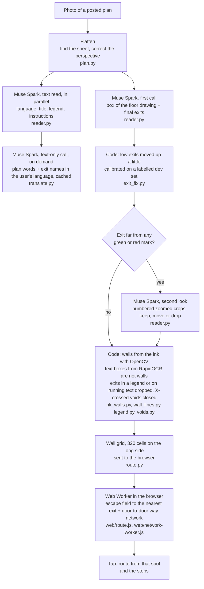

# HereOut

HereOut reads a photo of a posted evacuation plan and shows the way out from where you stand. You take a photo of the plan on the wall. Muse Spark finds the exits. You tap where you stand, and HereOut draws a route that stays inside the walls and gives the steps. It is for a person in an unfamiliar building (a hotel, a station, a school) who sees the plan but cannot read it fast, often because it is in another language. Muse Spark also reads the words on the plan, and the plan card (steps, exit names, title, legend, printed instructions) comes in the user's language.

Live: <https://hereout.devrives.com/>

Entry for the Meta Global AI Developer Hackathon (2026-10-26 to 2026-11-04 ET).

## Try it

1. Open <https://hereout.devrives.com/>.
2. Pick a plan from the gallery: 203 open-licensed photos of real posted plans. A gallery plan opens from a saved reading, so it makes no model call for the exits. Or upload your own photo of a plan.
3. Tap where you stand on the plan. The route and the steps appear. Tap another spot for another route.
4. Pick a language in the plan card, or let the browser pick it: Spanish, French, German, Italian, Portuguese, Russian, Ukrainian, Japanese, Korean, Simplified Chinese, Hindi or Arabic. "What the plan says" shows the plan's own title, legend and instructions, translated, each with its original text under it.
5. Open "What Muse Spark read" to see the floor box and exit points that the model gave, what the second look did with each one (with the zoomed crops the model saw), and what the code changed after the model.

## How it works



- The model gives the floor box, the exits and the words of the plan. The start always comes from the user's tap, not from the model.
- The browser finds every route. The server sends the wall grid once, and each tap is answered on the device.
- The steps name turns and say "short", "medium" or "long" walks. They give no metres, because a photo has no reliable scale.

## How Muse Spark is used

| Item | Value | Where |
|---|---|---|
| Model | `meta-models/muse-spark-open-1026` | `DEFAULT_MODEL` in `src/hereout/reader.py` |
| Provider | Baseten Model API, OpenAI-compatible chat completions (`https://inference.baseten.co/v1/chat/completions`) | `API_URL` |
| Mode | Standard mode only. The client refuses any model name that ends in `-contributor` (those send the content to training). | `ModelClient.__init__` |
| Settings | `reasoning_effort: low`, `temperature: 0`, `max_tokens: 12000` | `DEFAULT_EFFORT`, `MAX_TOKENS` |
| First call | `PROMPT`: the whole plan image (long side at most 1600 px); asks for the "final exits" and the box of the "floor drawing", as 0 to 1000 grid points, in JSON. A final exit is the end of an escape route: a door in the outer wall or the door of a protected staircase; on a plan with several levels, the exits of every level. | `PROMPT`, `parse_answer` |
| Second look | `ZOOM_PROMPT`: only for exits farther than 1.5 % of the long side from any green or red mark. Crops of 18 % of the long side around each suspect exit, marked with a cross, four to a sheet, with the full image. The model keeps, moves (at most 7 % of the long side) or drops each one. Skipped when the first call took more than 30 s. | `suspect_exits`, `zoom_exits`, `ZOOM_*` |
| Text read | `TEXT_PROMPT`: the same image, in parallel with the first call; the plan waits for it at most 2 s, and later words reach the page when the read ends. It gives the plan's language, title, legend entries and printed instructions (12 legend entries and instructions at most), each with its original text and an English text, and no positions. The plan opens without the words when the call fails. | `read_text`, `parse_plan_text` |
| Translation | `TRANSLATE_PROMPT`: a text-only call that translates the plan words and the exit labels into one of 12 languages, on demand. Gallery answers stay in a disk cache; the words of an uploaded photo stay in memory only. English needs no call, except for exit labels in another script. | `translate`, `src/hereout/translate.py` |
| Plan card texts | The texts of the plan card (steps, labels, messages) were translated once per language by Muse Spark with `scripts/translate_ui.py`. Three hand fixes after review (two Arabic steps, two Korean texts) are listed in `wiki/decisions/plan-language.md`. | `src/hereout/web/i18n/` |
| Time limits | 45 s for the first call (one more try on a timeout or a 5xx answer), 25 s for the second look | `CALL_TIMEOUT`, `ZOOM_TIMEOUT`, `MAIN_TRIES` |
| Spend cap | Every call goes through one `ModelClient`. It reserves the worst-case cost in a file ledger before the call and refuses a call that could pass the cap (`HEREOUT_SPEND_CAP_USD`, default 5 USD). A timed-out call is counted at the worst case. | `SpendLedger`, `ModelClient._ask` |
| Use limit | 12 photos to the model for each address in 10 minutes; after that the user marks the exits by hand | `READS_PER_WINDOW` in `src/hereout/app.py` |

HereOut uses no other Meta model. Walls, routes and steps come from code.

On the 203 gallery plans, the second look was run on the saved readings (`scripts/zoom_saved.py`): 142 plans had at least one suspect exit. The card of each sample shows the crops and the result.

## Evaluation

**Photo set.** 28 photos of posted plans from Wikimedia Commons, 14 countries and regions, none of them in the gallery that the code was tuned on: each photo that was in the gallery or near one (by title, source address or a perceptual hash) was left out. The photos are not in this repository.

**Labels.** Every final exit of each photo, as a point, by the definition in `PROMPT`. Each label is "sure" (the plan marks it: a route end, an exit sign, a legend exit icon) or "unsure" (the drawing suggests an exit but does not show it clearly). The labeller was an AI agent (Claude). It labelled by eye from the photos, with zoomed crops of each part of each plan, on 2026-11-01. The labeller saw no model reading of these photos before it labelled them. After the first scoring, each miss and false exit was checked on an overlay; one label was added (an outer door with no route, as "unsure"). Each change is logged in the labels file.

| | Count |
|---|---|
| Photos | 28 |
| Photos that cannot be judged | 2 (a town map with no building; a photo of a door that cuts off the plan) |
| Labelled exits | 112 (90 sure, 22 unsure) |

**Score** (`scripts/score_exits.py RUN_DIR labels.json`). Predicted exits are matched one to one to labels (Hungarian method) within a radius R = 5 % of the long side of the labelled floor box (at least 12 px). An unsure label may be matched or not; it is never a miss. Precision = hits / (hits + false exits); recall = hits / sure labels; "all right" = every sure label hit and no false exit. The script also reports R at 2.5 % and 10 %, and a strict score that counts unsure labels as sure.

| Code | R | Exit precision | Exit recall | Photos all right | Photos with a route |
|---|---|---|---|---|---|
| 2026-10-29 run (before later changes) | 2.5 % | 0.23 | 0.29 | 1 / 26 | 26 / 28 |
| | **5 %** | **0.42** | **0.52** | **4 / 26** | |
| | 10 % | 0.62 | 0.74 | 8 / 26 | |
| Current code (2026-11-01) | 2.5 % | 0.28 | 0.32 | 2 / 26 | 28 / 28 |
| | **5 %** | **0.47** | **0.53** | **6 / 26** | |
| | 10 % | 0.64 | 0.71 | 7 / 26 | |

"Photos with a route" means that the code found a way out for at least half of the open floor (`route_found` in `scripts/run_set.py`). It does not mean that the route is right.

Each code version was run once. Two reads of the same photo can differ, so a change of a few hundredths is within noise.

**Dev set.** The code was tuned on a separate dev set: 30 gallery plans picked at random by country (seed 20261101), labelled the same way, by agents that had not seen the readings. On it, Muse Spark's exits in the lower half of the image were consistently a little too low, so `exit_fix.py` moves them up by 10 % of their distance below the middle (dev set, 5 %: precision 0.357 to 0.391, recall 0.348 to 0.383, four reads; better on both random halves of the dev set, and no read got worse). A new prompt scored within the noise between two reads and did not ship. No exit rule was chosen on the holdout photos. Only the time limits of the model calls, and the skip of the second look after a slow first call, came from their slow calls on 2026-10-29.

On the overlays of the 2026-10-29 run, the misses and false exits were points on the sign or the name plate beside a stair instead of its door, points on the paper or the street outside the building, the same exit given twice (stair and sign), direction signs along a corridor taken as exits, and staircases on a ground floor where every printed route goes past them to the main door. Some points are on the right door but just outside R, which is why the scores at 10 % are higher.

## Limits

- The exits are the weak part. On the photo set above, the current code found about half of the labelled exits, and about half of the exits it gave were false (radius 5 %). A wrong exit gives a wrong route, so every route says to check it against the plan, and the user can mark an exit by hand.
- The model can give different exits for the same photo in different reads.
- A route does not go from the stairs of one level to the exits of another level. Each level is a separate drawing.
- Walls come from the ink. Wavy walls and the grey middle of a printed escape arrow can give wrong walls, so a route can cross a wall or find no way.
- A plan that is small in the photo, cut off, or seen through glare is read badly.
- The steps give no distances, and the first step names a side of the plan ("toward the top of the plan"), not left or right of your body.
- HereOut is a reading aid. Follow the signs, the staff and the emergency services.

## Run locally

Python 3.12 or later with [uv](https://docs.astral.sh/uv/). Node.js is needed only for the tests that run the browser code (`web/route.js`); they are skipped without it.

```sh
uv sync
uv run pytest -q
```

Create `.env` (it is in `.gitignore`; never commit it):

```sh
BASETEN=<your Baseten API key>
HEREOUT_SPEND_CAP_USD=5      # spend cap for this ledger
# optional: HEREOUT_LEDGER=.cache/spend.json  HEREOUT_EFFORT=low  HEREOUT_MODEL=...
# optional: HEREOUT_GALLERY=<folder made by scripts/run_set.py>  HEREOUT_VIDEO=<folder with demo.mp4>
```

```sh
uv run --env-file .env uvicorn hereout.app:app --port 8000
```

Without a key the server still runs: the user marks the exits by hand. The gallery photos are not in this repository, so a local server has no gallery unless `HEREOUT_GALLERY` points to a folder made with `scripts/run_set.py`.

Evaluation on a photo set (the folder must be outside the repository):

```sh
uv run --env-file .env python scripts/run_set.py <index.csv> <out folder> --workers 2   # paid: one or two model calls per photo
uv run python scripts/score_exits.py <out folder> <labels.json> --overlays <out folder>/score
uv run python scripts/score_exits.py <gallery folder> <labels.json> --gallery --out <file>   # saved gallery readings, no model call
```

## Project layout

```
src/hereout/
  app.py          FastAPI server: upload jobs, gallery, static page, use limit
  pipeline.py     photo -> flat plan -> reading -> walls -> answer for the browser
  plan.py         find the sheet and correct the perspective
  reader.py       Muse Spark client: prompts, second look, text read, translation, spend ledger
  exit_fix.py     y calibration of the first call's exits
  translate.py    languages, translation items, cache
  legend.py       drop exits that fall in the legend or on running text
  voids.py        close rectangles crossed by an X (lift shafts, voids)
  photo_map.py    detect a route printed on an aerial photo
  walls.py, ink_walls.py, wall_lines.py   walls from the ink; RapidOCR text boxes
  route.py        wall grid, escape field (Python twin of web/route.js)
  steps.py        steps (Python twin of the browser code)
  gallery.py      saved gallery readings and answers
  web/            page, route.js (field, routes, steps), network-worker.js, i18n.js and i18n/ (plan card texts)
scripts/          run_set.py, summarize_set.py, score_exits.py, save_answers.py, try_photos.py,
                  zoom_saved.py, read_text.py, translate_ui.py
tests/            pytest, plus node checks of web/route.js
wiki/             decisions, components and history (why and when)
```

## Data and licences

- Gallery: 203 photos of posted plans, 164 from Wikimedia Commons and 39 from Flickr, all under open licences (CC0, public domain mark, CC BY, CC BY-SA). The app shows the credit of each photo: title, author, licence, source link and what was changed.
- The photos, the gallery readings and the evaluation labels are not in this repository. The photos belong to their authors.

## Built during the hackathon

All code in this repository was written during the hackathon; the first commit is from 2026-10-27 00:59 CET (2026-10-26 ET). The `wiki/` folder records each decision and its reason.
