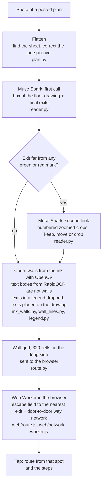

# HereOut

HereOut reads a photo of a posted evacuation plan and shows the way out from where you stand. You take a photo of the plan on the wall. Muse Spark finds the exits. You tap where you stand, and HereOut draws a route that stays inside the walls and gives the steps. It is for a person in an unfamiliar building (a hotel, a station, a school) who sees the plan but cannot read it fast.

Live: <https://hereout.devrives.com/>

Entry for the Meta Global AI Developer Hackathon (2026-10-26 to 2026-11-04 ET).

## Try it

1. Open <https://hereout.devrives.com/>.
2. Pick a plan from the gallery: 203 open-licensed photos of real posted plans. A gallery plan opens from a saved reading, so it makes no model call. Or upload your own photo of a plan.
3. Tap where you stand on the plan. The route and the steps appear. Tap another spot for another route.

TBD(lang): plan text read and translated into your language with Muse Spark.

TBD(zoom): the second look on the exits, made visible on the samples.

## How it works



- The model gives only the floor box and the exits. The start always comes from the user's tap, not from the model.
- The browser finds every route. The server sends the wall grid once, and each tap is answered on the device.
- The steps name turns and say "short", "medium" or "long" walks. They give no metres, because a photo has no reliable scale.

## How Muse Spark is used

| Item | Value | Where |
|---|---|---|
| Model | `meta-models/muse-spark-open-1026` | `DEFAULT_MODEL` in `src/hereout/reader.py` |
| Provider | Baseten Model API, OpenAI-compatible chat completions (`https://inference.baseten.co/v1/chat/completions`) | `API_URL` |
| Mode | Standard mode only. The client refuses any model name that ends in `-contributor` (those send the content to training). | `ModelClient.__init__` |
| Settings | `reasoning_effort: low`, `temperature: 0`, `max_tokens: 12000` | `DEFAULT_EFFORT`, `MAX_TOKENS` |
| First call | `PROMPT`: the whole plan image (long side at most 1600 px); asks for the "final exits" and the box of the "floor drawing", as 0 to 1000 grid points, in JSON. A final exit is the end of an escape route: a door in the outer wall or the door of a protected staircase; on a plan with several levels, the exits of every level. | `PROMPT`, `parse_answer` |
| Second look | `ZOOM_PROMPT`: only for exits farther than 1.5 % of the long side from any green or red mark. Crops of 18 % of the long side around each suspect exit, marked with a cross, four to a sheet, with the full image. The model keeps, moves (at most 7 % of the long side) or drops each one. Skipped when the first call took more than 30 s. | `suspect_exits`, `zoom_exits`, `ZOOM_*` |
| Time limits | 45 s for the first call (one more try on a timeout or a 5xx answer), 25 s for the second look | `CALL_TIMEOUT`, `ZOOM_TIMEOUT`, `MAIN_TRIES` |
| Spend cap | Every call goes through one `ModelClient`. It reserves the worst-case cost in a file ledger before the call and refuses a call that could pass the cap (`HEREOUT_SPEND_CAP_USD`, default 5 USD). A timed-out call is counted at the worst case. | `SpendLedger`, `ModelClient._ask` |
| Use limit | 12 photos to the model for each address in 10 minutes; after that the user marks the exits by hand | `READS_PER_WINDOW` in `src/hereout/app.py` |

HereOut uses no other Meta model. Walls, routes and steps come from code.

## Evaluation

There was no ground truth before 2026-11-01. This section gives the labels and the method; the numbers for the current code come from a paid run that is still to do.

**Photo set.** 28 photos of posted plans from Wikimedia Commons, 14 countries, none of them in the gallery that the code was tuned on: each photo that was in the gallery or near one (by title, source address or a perceptual hash) was left out. The photos are not in this repository.

**Labels.** Every final exit of each photo, as a point, by the definition in `PROMPT`. Each label is "sure" (the plan marks it: a route end, an exit sign, a legend exit icon) or "unsure" (the drawing suggests an exit but does not show it clearly). The labeller was an AI agent (Claude), by eye from the photos with zoomed crops of each part of each plan, on 2026-11-01, before any model reading of these photos was opened. After the first scoring, each miss and false exit was checked on an overlay; one label was added (an outer door with no route, as "unsure"). Each change is logged in the labels file.

| | Count |
|---|---|
| Photos | 28 |
| Photos that cannot be judged | 2 (a town map with no building; a photo of a door that cuts off the plan) |
| Labelled exits | 112 (90 sure, 22 unsure) |

**Score** (`scripts/score_exits.py RUN_DIR labels.json`). Predicted exits are matched one to one to labels (Hungarian method) within a radius R = 5 % of the long side of the labelled floor box (at least 12 px). An unsure label may be matched or not; it is never a miss. Precision = hits / (hits + false exits); recall = hits / sure labels; "all right" = every sure label hit and no false exit. The script also reports R at 2.5 % and 10 %, and a strict score that counts unsure labels as sure.

| Code | R | Exit precision | Exit recall | Photos all right | Photos with a route |
|---|---|---|---|---|---|
| 2026-10-29 run (before later changes) | 2.5 % | 0.23 | 0.29 | 1 / 26 | 26 / 28 |
| | **5 %** | **0.42** | **0.52** | **4 / 26** | |
| | 10 % | 0.62 | 0.74 | 8 / 26 | |
| Current code | 5 % | TBD | TBD | TBD | TBD |

"Photos with a route" means that the code found a way out for at least half of the open floor (`route_found` in `scripts/run_set.py`). It does not mean that the route is right.

What the misses and false exits on the 2026-10-29 run were, from the overlays: points on the sign or the name plate beside a stair instead of its door, points on the paper or the street outside the building, the same exit given twice (stair and sign), direction signs along a corridor taken as exits, and staircases on a ground floor where every printed route goes past them to the main door. Some points are on the right door but just outside R, which is why the scores at 10 % are higher.

## Limits

- The exits are the weak part. On the photo set above, about half of the exits were found and about half of the given exits were false (2026-10-29 code). A wrong exit gives a wrong route.
- The model can give different exits for the same photo in different reads.
- A route does not go from the stairs of one level to the exits of another level. Each level is a separate drawing.
- Walls come from the ink. Wavy walls and the grey middle of a printed escape arrow can give wrong walls, so a route can cross a wall or find no way.
- A plan that is small in the photo, cut off, or seen through glare is read badly.
- The steps give no distances, and the first step names a side of the plan ("toward the top of the plan"), not left or right of your body.
- HereOut is a reading aid. Follow the signs, the staff and the emergency services.

## Run locally

Python 3.12 or later with [uv](https://docs.astral.sh/uv/). Node.js is needed only for the tests that run the browser code (`web/route.js`); they are skipped without it.

```sh
uv sync
uv run pytest -q
```

Create `.env` (it is in `.gitignore`; never commit it):

```sh
BASETEN=<your Baseten API key>
HEREOUT_SPEND_CAP_USD=5      # spend cap for this ledger
# optional: HEREOUT_LEDGER=.cache/spend.json  HEREOUT_EFFORT=low  HEREOUT_MODEL=...
# optional: HEREOUT_GALLERY=<folder made by scripts/run_set.py>  HEREOUT_VIDEO=<folder with demo.mp4>
```

```sh
uv run --env-file .env uvicorn hereout.app:app --port 8000
```

Without a key the server still runs: the user marks the exits by hand. The gallery photos are not in this repository, so a local server has no gallery unless `HEREOUT_GALLERY` points to a folder made with `scripts/run_set.py`.

Evaluation on a photo set (the folder must be outside the repository):

```sh
uv run --env-file .env python scripts/run_set.py <index.csv> <out folder> --workers 2   # paid: one or two model calls per photo
uv run python scripts/score_exits.py <out folder> <labels.json> --overlays <out folder>/score
uv run python scripts/score_exits.py <gallery folder> <labels.json> --gallery --out <file>   # saved gallery readings, no model call
```

## Project layout

```
src/hereout/
  app.py          FastAPI server: upload jobs, gallery, static page, use limit
  pipeline.py     photo -> flat plan -> reading -> walls -> answer for the browser
  plan.py         find the sheet and correct the perspective
  reader.py       Muse Spark client: prompts, second look, spend ledger
  legend.py       drop exits that fall in the legend
  photo_map.py    detect a route printed on an aerial photo
  walls.py, ink_walls.py, wall_lines.py   walls from the ink; RapidOCR text boxes
  route.py        wall grid, escape field (Python twin of web/route.js)
  steps.py        steps (Python twin of the browser code)
  gallery.py      saved gallery readings and answers
  web/            page, route.js (field, routes, steps), network-worker.js
scripts/          run_set.py, summarize_set.py, score_exits.py, save_answers.py, try_photos.py
tests/            pytest, plus node checks of web/route.js
wiki/             decisions, components and history (why and when)
```

## Data and licences

- Gallery: 203 photos of posted plans, 164 from Wikimedia Commons and 39 from Flickr, all under open licences (CC0, public domain mark, CC BY, CC BY-SA). The app shows the credit of each photo: title, author, licence, source link and what was changed.
- The photos, the gallery readings and the evaluation labels are not in this repository. The photos belong to their authors.

## Built during the hackathon

All code in this repository was written during the hackathon; the first commit is from 2026-10-27. The `wiki/` folder records each decision and its reason.
